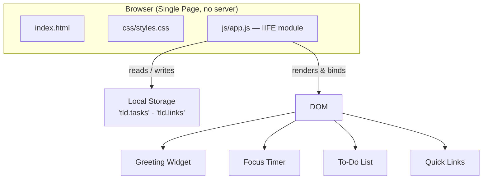
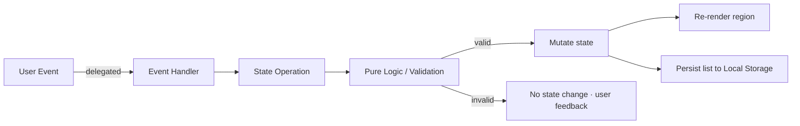
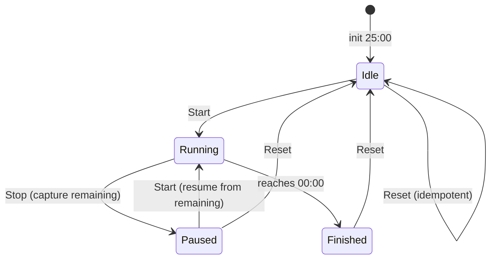

# Design Document

## Overview

The To-Do Life Dashboard is a single-page web application built with plain HTML, CSS, and vanilla JavaScript. It runs entirely in the browser with no backend server and no frontend framework. Four self-contained widgets share one page: a Greeting Widget (live clock, date, and time-of-day greeting), a Focus Timer (a 25-minute Pomodoro countdown), a To-Do List (full CRUD with completion toggling), and Quick Links (one-click buttons to favorite sites).

All user data — Tasks and Links — is persisted client-side through the browser Local Storage API, so the dashboard works offline and restores its state across browser sessions. The application is intentionally minimal: exactly one CSS file in `css/` and one JavaScript file in `js/`, plus a single `index.html`. It targets modern Chrome, Firefox, Edge, and Safari.

### Design Goals

- **Simplicity and zero dependencies**: No build step is required to run the app. Opening `index.html` (even via `file://`) renders a working dashboard.
- **Testable pure logic**: Validation, serialization, greeting logic, and timer math are written as pure functions and exposed for automated testing while DOM wiring stays private.
- **Resilient persistence**: Data round-trips through Local Storage losslessly; corrupt or missing data degrades gracefully to empty lists.
- **Responsive feel**: UI updates complete well within the 200ms budget required by the spec.

### Research Summary

Two areas required research before design:

1. **Countdown timer accuracy.** A naive `setInterval(decrement, 1000)` drifts because browsers throttle timers in background tabs and each callback fires late, with errors compounding over a 25-minute run. The established fix is to stop counting ticks and instead measure against an absolute end timestamp: on Start, record `endTime = Date.now() + remainingMs`; on each tick, recompute `remainingMs = endTime - Date.now()`. The displayed value then tracks true elapsed time even when ticks arrive late. ([Why setInterval drifts and how to fix it](https://dev.to/work_hau_cb718f47075930f9/javascript-countdown-timers-why-setinterval-drifts-and-how-to-fix-it-26fe), [Build a Zero-Drift Web Timer](https://dev.to/raylabs/build-a-zero-drift-web-timer-3bip))

2. **Property-based testing for JavaScript.** [fast-check](https://github.com/dubzzz/fast-check) is the standard PBT library for JavaScript/TypeScript. It is test-runner-agnostic and integrates cleanly with Jest (and jsdom), which is the chosen stack for this project's tests ([npm](https://www.npmjs.com/package/fast-check)). The serialization round-trip and validation logic called out in the requirements are ideal PBT targets.

## Architecture

The application is a single page with four widget regions. A single IIFE-wrapped module (`js/app.js`) owns an in-memory state object, exposes pure helper functions on a `window.Dashboard` namespace for testing, and bootstraps the DOM only when the real page is present. There is no framework, no virtual DOM, and no build pipeline for the shipped app.

### High-Level Structure



### State Management

Vanilla JavaScript state management is handled by a single module-private `state` object. Widgets never hold their own copies of shared data; they read from and mutate `state` through small, named operations, then trigger a re-render of the affected region and a persist of the affected list.

```javascript
const state = {
  tasks: [],          // Task[]  — source of truth for the To-Do List
  links: [],          // Link[]  — source of truth for Quick Links
  timer: {
    durationMs: 25 * 60 * 1000,   // fixed 25 minutes (Requirement 2.1)
    remainingMs: 25 * 60 * 1000, // current remaining time
    running: false,              // is the countdown active?
    endTime: null,               // epoch ms when running, for drift-free math
    intervalId: null             // active setInterval handle
  }
};
```

The Greeting Widget is read-only (it derives everything from the current `Date`), so it holds no persistent state — only a clock interval.

### Data Flow

All mutations follow the same one-directional pipeline: a delegated user event calls a state operation, which runs validation/pure logic, updates `state`, re-renders the affected widget region, and persists the affected list to Local Storage.



### Rendering Approach

Rendering uses targeted DOM updates rather than full-page re-renders, for two reasons: it keeps edit-in-place interactions from losing input focus, and it stays well within the 200ms responsiveness budget. Each list (tasks, links) renders rows via `document.createElement` (safe, no `innerHTML` injection of user content). Event delegation attaches a single listener per list container; the handler dispatches on `data-action` attributes (`add`, `edit`, `save`, `toggle`, `delete`) so newly added rows need no individual listeners.

### Event Handling

- **Event delegation**: one listener per container (`#todo-list`, `#quick-links`, `#timer-controls`) inspects `event.target.closest('[data-action]')` to find the action and any associated `data-id`. This keeps listener count constant and handles dynamically added rows automatically.
- **Form submission**: the add-task and add-link forms use `submit` events with `preventDefault` so Enter and button-click both work and the page never reloads.
- **Timer controls**: Start/Stop/Reset are button clicks handled by the timer controller.

## Components and Interfaces

Each widget is a logical component: it owns a render function, an event-binding routine, and (where relevant) the state operations that mutate shared `state`. Components communicate only through the shared `state` object and the persist helpers — there is no direct widget-to-widget coupling.

### Greeting Widget

- **Responsibility**: Display local time (HH:MM:SS), local date, and a time-of-day greeting; update the clock every second.
- **Interface**:
  - `renderGreeting(date)` — pure: returns `{ time, date, greeting }` strings for a given `Date`.
  - `startGreetingClock()` — sets a 1000ms interval that calls `renderGreeting(new Date())` and writes the result into the DOM elements.
- **Key logic** — `greetingForDate(date)`: a pure function mapping a `Date` to one of four greetings based on seconds-since-midnight (see Data Models / Algorithms). This pure mapping is a prime property-based test target.

### Focus Timer

- **Responsibility**: 25-minute countdown with Start, Stop, Reset.
- **Interface**:
  - `timerStart()`, `timerStop()`, `timerReset()` — state operations.
  - `formatDuration(ms)` — pure: converts milliseconds to `MM:SS`.
  - `tick()` — internal: recomputes `remainingMs = endTime - Date.now()`, updates the display, and stops at 00:00.
- **State machine**:



- **Drift-free algorithm** (from research): on Start, set `endTime = Date.now() + remainingMs` and `running = true`, then start `setInterval(tick, 1000)`. Each `tick` recomputes remaining time from `endTime` rather than decrementing, so late ticks never accumulate error. On Stop, capture `remainingMs = endTime - Date.now()`, set `running = false`, and clear the interval. On Reset, set `remainingMs = durationMs`, `running = false`, clear the interval, and display 25:00.

### To-Do List

- **Responsibility**: Add, edit, toggle, and delete Tasks with validation; persist after each operation.
- **Interface**:
  - `addTask(text)`, `editTask(id, text)`, `toggleTask(id)`, `deleteTask(id)` — state operations returning a success/failure indicator.
  - `validateTaskText(text)` — pure: returns `true` iff length is 1–200 and the string contains at least one non-whitespace character.
  - `renderTaskList()` — rebuilds the task rows from `state.tasks`.
- **Validation rules** (Requirement 3.1, 3.5, 3.10):
  - Reject empty or whitespace-only text.
  - Reject text longer than 200 characters.
  - Boundaries: 200 characters with at least one non-whitespace character is valid; 201 is invalid.

### Quick Links

- **Responsibility**: Add, delete Links; render a button per Link; open the URL in a new tab on click.
- **Interface**:
  - `addLink(name, url)`, `deleteLink(id)` — state operations.
  - `validateLink(name, url)` — pure: returns `true` iff name is 1–100 non-whitespace-only characters and url is non-empty/non-whitespace-only.
  - `renderLinkList()` — rebuilds link buttons from `state.links`.
  - `openLink(url)` — calls `window.open(url, '_blank', 'noopener,noreferrer')`.
- **Validation rules** (Requirement 4.4): reject empty/whitespace-only name, name > 100 chars, or empty/whitespace-only URL. URL scheme is not validated beyond non-empty/non-whitespace, matching the requirements exactly; a security note on `javascript:` URLs is captured in Error Handling.

### Persistence Layer

- **Responsibility**: Serialize/deserialize Tasks and Links to/from Local Storage; handle parse failures and write failures gracefully.
- **Interface**:
  - `serializeTasks(tasks)` / `deserializeTasks(json)` — pure, round-trippable.
  - `serializeLinks(links)` / `deserializeLinks(json)` — pure, round-trippable.
  - `saveTasks()`, `saveLinks()` — write to Local Storage, surfacing a user-visible error on `QuotaExceededError` while keeping data in memory (Requirement 5.6).
  - `loadAll()` — read both keys on startup, falling back to empty lists on missing or unparseable data (Requirement 5.4, 5.5).

## Data Models

### Task

```typescript
interface Task {
  id: string;    // stable identifier (crypto.randomUUID() with fallback)
  text: string;  // 1–200 chars, at least one non-whitespace character
  done: boolean; // completion status: false = not-done, true = done
}
```

The `id` exists to give edit/toggle/delete a stable target that survives reordering (an array index would shift on deletion). It is preserved through serialization so the round-trip is exact.

### Link

```typescript
interface Link {
  id: string;    // stable identifier
  name: string;  // display name, 1–100 chars, non-whitespace-only
  url: string;   // target URL, non-empty / non-whitespace-only
}
```

### Local Storage Schema

Two separate keys isolate failures and keep write payloads small:

| Key | Value | Shape |
| --- | --- | --- |
| `tld.tasks` | JSON string | `Task[]` |
| `tld.links` | JSON string | `Link[]` |

A namespaced prefix (`tld.`) avoids collisions with other apps on the same origin.

### Key Algorithms

**Greeting from time of day** — pure, uses seconds-since-midnight `t = h*3600 + m*60 + s`:

| Range (seconds since midnight) | Greeting |
| --- | --- |
| `18000` ≤ t ≤ `43199` (05:00:00–11:59:59) | Good morning |
| `43200` ≤ t ≤ `61199` (12:00:00–16:59:59) | Good afternoon |
| `61200` ≤ t ≤ `75599` (17:00:00–20:59:59) | Good evening |
| `t ≥ 75600` OR `t ≤ 17999` (21:00:00–04:59:59, spans midnight) | Good night |

**Task validation** — `validateTaskText(text)`:
- `typeof text === 'string'`
- `text.length >= 1 && text.length <= 200`
- `text.trim().length >= 1` (rejects whitespace-only)

**Link validation** — `validateLink(name, url)`:
- `name`: string, length 1–100, `name.trim().length >= 1`
- `url`: string, `url.trim().length >= 1`

**Serialization / deserialization** — `serializeTasks`/`serializeLinks` use `JSON.stringify`; the matching `deserialize*` parse with `JSON.parse`, then validate that the result is an array whose elements conform to the model shape (correct types, valid lengths). Any parse error or shape violation causes the deserializer to return `[]`, satisfying Requirement 5.5. This pair is the foundation of the round-trip correctness properties.

**ID generation** — `crypto.randomUUID()` when available, falling back to `'tld-' + Date.now() + '-' + Math.random().toString(36).slice(2)` for older browsers and jsdom test environments.

## Correctness Properties

*A property is a characteristic or behavior that should hold true across all valid executions of a system — essentially, a formal statement about what the system should do. Properties serve as the bridge between human-readable specifications and machine-verifiable correctness guarantees.*

The following properties were derived from the requirements via prework analysis and consolidated to remove redundancy. Each is universally quantified and references the acceptance criteria it validates. The validation logic (task/link list operations, serialization, greeting, timer math) is implemented as pure functions exposed on `window.Dashboard` so they can be exercised by fast-check with a mocked clock and an in-memory Local Storage stand-in.

### Property 1: Greeting is a total, disjoint partition of the day

For any `Date`, `greetingForDate(date)` returns exactly one of "Good morning", "Good afternoon", "Good evening", or "Good night", and the returned greeting is the one whose seconds-since-midnight range contains the given time (with the night range wrapping across midnight: `t >= 75600` or `t <= 17999`). Adjacent ranges meet at their inclusive boundaries (e.g., 11:59:59 → morning, 12:00:00 → afternoon) with no gaps and no overlap.

**Validates: Requirements 1.3, 1.4, 1.5, 1.6**

### Property 2: Clock formatting reflects the input date

For any `Date`, `formatTime(date)` yields a string of the form `HH:MM:SS` whose zero-padded hours, minutes, and seconds equal the corresponding components of the date; and `formatDate(date)` yields a string containing the day, month, and year of the date.

**Validates: Requirements 1.1, 1.2**

### Property 3: Remaining time is monotonic, non-negative, and stops at zero

For any timer `endTime` and any sequence of increasing "now" timestamps, the computed remaining time equals `max(0, endTime - now)`, never increases as `now` advances, and when `now >= endTime` the remaining time is `0` (displayed as `00:00`) and the timer is stopped.

**Validates: Requirements 2.2, 2.6**

### Property 4: Reset is idempotent and reaches a fixed point

For any timer state, `timerReset()` sets the remaining time to 25:00 (25 \* 60 \* 1000 ms) and the running flag to false, and applying `timerReset()` again produces the same state (`f(x) == f(f(x))`).

**Validates: Requirements 2.4**

### Property 5: Adding a valid task grows the list by exactly one

For any task list and any text that passes `validateTaskText` (1–200 chars with at least one non-whitespace character), `addTask(text)` returns a list one element longer whose new last element has the given text and `done === false`, with all prior tasks unchanged and in their original order.

**Validates: Requirements 3.1**

### Property 6: Editing a task replaces only the target

For any task list, any task `id` present in the list, and any valid replacement text, `editTask(id, text)` yields a list of the same length where only the task with that `id` has its text changed and all other tasks (including their text, `done` status, `id`, and position) are unchanged.

**Validates: Requirements 3.2**

### Property 7: Toggle is an involution

For any task list and any task `id` present in the list, applying `toggleTask(id)` flips that task's `done` status, and applying `toggleTask(id)` a second time restores the task to its original `done` value (a single toggle inverts, a double toggle is identity), with list length and order unchanged.

**Validates: Requirements 3.3**

### Property 8: Deleting a task removes it and preserves the rest

For any task list and any task `id` present in the list, `deleteTask(id)` yields a list one element shorter that no longer contains a task with that `id`, while the remaining tasks keep their original relative order, text, and `done` status.

**Validates: Requirements 3.4**

### Property 9: Invalid task text is rejected by add and edit

For any task list and any text that fails `validateTaskText` (empty, whitespace-only, or longer than 200 characters), `addTask(text)` leaves the list unchanged and signals rejection; and for any list, any task `id` present in the list, and any such invalid text, `editTask(id, text)` likewise leaves the list unchanged and signals rejection. Boundary: text of exactly 200 characters with a non-whitespace character is valid; 201 characters is invalid.

**Validates: Requirements 3.5, 3.10**

### Property 10: Task serialization round-trips losslessly

For any valid task list, `deserializeTasks(serializeTasks(list))` produces an equivalent list — the same number of tasks, with each task at the same index retaining its original text, `done` status, and `id`.

**Validates: Requirements 3.9**

### Property 11: Adding a valid link grows the list by exactly one

For any link list and any `(name, url)` that passes `validateLink` (name 1–100 non-whitespace-only chars, url non-empty/non-whitespace-only), `addLink(name, url)` returns a list one element longer whose new last element has the given name and url, with prior links unchanged and in original order.

**Validates: Requirements 4.1**

### Property 12: Deleting a link removes it and preserves the rest

For any link list and any link `id` present in the list, `deleteLink(id)` yields a list one element shorter that no longer contains a link with that `id`, while remaining links keep their original relative order, name, and url.

**Validates: Requirements 4.3**

### Property 13: Invalid link input is rejected by add

For any link list and any `(name, url)` that fails `validateLink` (empty/whitespace-only name, name longer than 100 characters, or empty/whitespace-only url), `addLink(name, url)` leaves the list unchanged and signals rejection. Boundary: name of exactly 100 characters with a non-whitespace character is valid; 101 characters is invalid.

**Validates: Requirements 4.4**

### Property 14: Link serialization round-trips losslessly

For any valid link list, `deserializeLinks(serializeLinks(list))` produces an equivalent list — the same number of links, with each link at the same index retaining its original name, url, and `id`.

**Validates: Requirements 4.8**

### Property 15: Invalid persisted data deserializes to an empty list

For any string that is not a valid serialization of a task list (malformed JSON, wrong top-level type, or an array containing elements that do not conform to the Task shape), `deserializeTasks` returns `[]`; and likewise for any string that is not a valid serialization of a link list, `deserializeLinks` returns `[]`.

**Validates: Requirements 5.5**

## Error Handling

The dashboard degrades gracefully and never loses in-memory data when persistence fails.

- **Local Storage write failure (`QuotaExceededError` or security exception):** the save helper catches the thrown error, surfaces a user-visible error message ("Saving failed — your changes are kept for this session but may not be saved"), and keeps the current `state.tasks` / `state.links` intact in memory (Requirement 5.6). The UI remains fully usable for the session.
- **Corrupt or unparseable stored data on load:** `deserializeTasks` / `deserializeLinks` validate structure and type after `JSON.parse`; any parse throw or shape mismatch returns `[]`, so a corrupted key initializes an empty list rather than crashing the app (Requirement 5.5). Missing keys are treated the same way (Requirement 5.4).
- **Invalid user input (task/link add and edit):** validation functions reject empty/whitespace-only/over-length inputs; the offending operation is a no-op on state and the input is not cleared, so the user can correct it. No exception is thrown — the operation returns a failure signal.
- **Timer edge cases:** the remaining-time computation clamps to `0` so the display never shows a negative value; reaching 00:00 clears the interval so the timer stops exactly once. Starting from an already-finished state recomputes `endTime` correctly.
- **Quick Links security:** links open with `window.open(url, '_blank', 'noopener,noreferrer')` to prevent the opened page from accessing the dashboard via `window.opener`. The requirements specify no URL-scheme validation beyond non-empty/non-whitespace (Requirement 4.4); as a defensive measure, the opener is advised that `javascript:` scheme URLs are a known self-inflicted risk when users add their own links, and the design follows the requirements strictly without rejecting schemes, relying on browser mitigations for `javascript:` in `window.open`.
- **Missing DOM in non-browser contexts:** the bootstrap `init()` guards on the presence of the root element and no-ops when absent, so loading `app.js` in a jsdom test environment (where widgets are not mounted) does not throw.

## Testing Strategy

### Dual Testing Approach

The project uses both example-based and property-based tests, complementary by design:

- **Unit / example tests** cover specific scenarios, component integration points, edge cases, and the DOM-rendering and event-delegation behavior that is not amenable to universal properties.
- **Property-based tests** cover the universal properties in the Correctness Properties section across a large randomized input space.

### Test Stack

- **Runner:** Jest with the `jsdom` test environment. `jsdom` provides a DOM so event delegation, rendering, and `window.open`/Local Storage interactions can be exercised in-process.
- **Property-based testing:** [fast-check](https://github.com/dubzzz/fast-check), integrated with Jest, run with a minimum of **100 iterations per property** (per the randomization requirement).
- **Test layout:** test files live under `test/` and are dev-only. They are not part of the shipped app and do not count toward the "exactly one JS file in `js/`" constraint (Requirement 7.2), which governs the application source, not the test toolchain. `package.json` declares only dev dependencies (Jest, jsdom, fast-check) and contains no runtime server.

### Pure-Function Exposure for Testing

`js/app.js` is a single non-module IIFE so it works via `file://` (ES modules are blocked under `file://`). It defines all pure logic first and attaches it to `window.Dashboard` (e.g., `greetingForDate`, `formatTime`, `formatDate`, `validateTaskText`, `validateLink`, `serializeTasks`, `deserializeTasks`, `serializeLinks`, `deserializeLinks`, `addTask`, `editTask`, `toggleTask`, `deleteTask`, `addLink`, `deleteLink`, `timerReset`, and a clock-injectable remaining-time helper). The DOM bootstrap runs only when the page's root element exists, so loading the file in jsdom exposes the pure functions without side effects. Tests reference `window.Dashboard.*` (and a fake clock / in-memory storage) to exercise properties.

### Property-Based Tests

Each correctness property is implemented as a single fast-check property test, configured for a minimum of 100 runs, and tagged with a comment referencing the design property:

- Generators: `fc.string({ minLength: 1, maxLength: 200 })` filtered to "contains a non-whitespace char" for valid task text; an explicit invalid generator (empty, all-whitespace, or length > 200) for rejection properties; arbitrary `Task[]` / `Link[]` with valid fields for round-trip properties; arbitrary seconds-since-midnight (0–86399) for the greeting partition; increasing timestamp sequences for the timer property; and malformed/wrong-shape JSON strings for the corrupt-data property.
- Each test file includes a comment tag in the form **Feature: todo-life-dashboard, Property N: \<property text\>**.
- The serialization round-trips (Properties 10 and 14) use an in-memory Local Storage mock (a simple object implementing `getItem`/`setItem`) so the persist+load path is exercised without browser dependency.

### Unit / Example Tests

- **Greeting widget:** example asserting the clock interval is scheduled and the DOM time/date/greeting elements update.
- **Focus timer:** examples for Start→Stop (remaining preserved), Reset from paused/running/finished states, and the 00:00 stop; a performance example asserting a render completes in under 200ms (Requirement 6.3).
- **To-Do List / Quick Links DOM:** examples for add (form submit and Enter key), edit-in-place save, toggle visual state, delete, and Quick Links button-click opens the URL in a new tab with `noopener` (mocked `window.open`).
- **Persistence integration:** populate storage, call `loadAll` (simulating reload), assert tasks and links restored (Requirement 5.2); missing-key and corrupt-key cases initialize empty (Requirements 5.4, 5.5); forced `setItem` throw surfaces an error and retains in-memory data (Requirement 5.6).

### Smoke / Integration Tests

- **No-network constraint (Requirement 5.3):** instrument global `fetch`, `XMLHttpRequest`, `WebSocket`, and `navigator.sendBeacon` and assert none are invoked across a full add/edit/toggle/delete/persist sequence.
- **Project structure (Requirements 7.1, 7.2, 7.3):** assert exactly one `.css` file under `css/`, exactly one `.js` file under `js/`, and that `index.html` loads no framework script and exposes no framework globals.
- **Cross-browser (Requirement 7.4):** a jsdom load asserts no thrown errors; a manual/CI smoke pass across Chrome, Firefox, Edge, and Safari asserts no console errors. Note: full cross-browser validation, including assistive-technology compatibility for the contrast/font-size requirement (6.2), ultimately requires manual testing in the target browsers; WCAG conformance likewise requires manual AT review.

### What Is Not Property-Tested (and Why)

- UI rendering, layout, and visual separation (Requirements 6.1, 6.2) are not input-varying computations — they are covered by example/visual checks.
- Real Local Storage I/O and cross-session restore (Requirements 5.1, 5.2, 5.6) are integration concerns; the underlying logic is property-tested through mocks, and the wiring is integration-tested.
- The no-server and project-structure constraints (Requirements 5.3, 7.1–7.4) are smoke checks because behavior does not vary with input.
